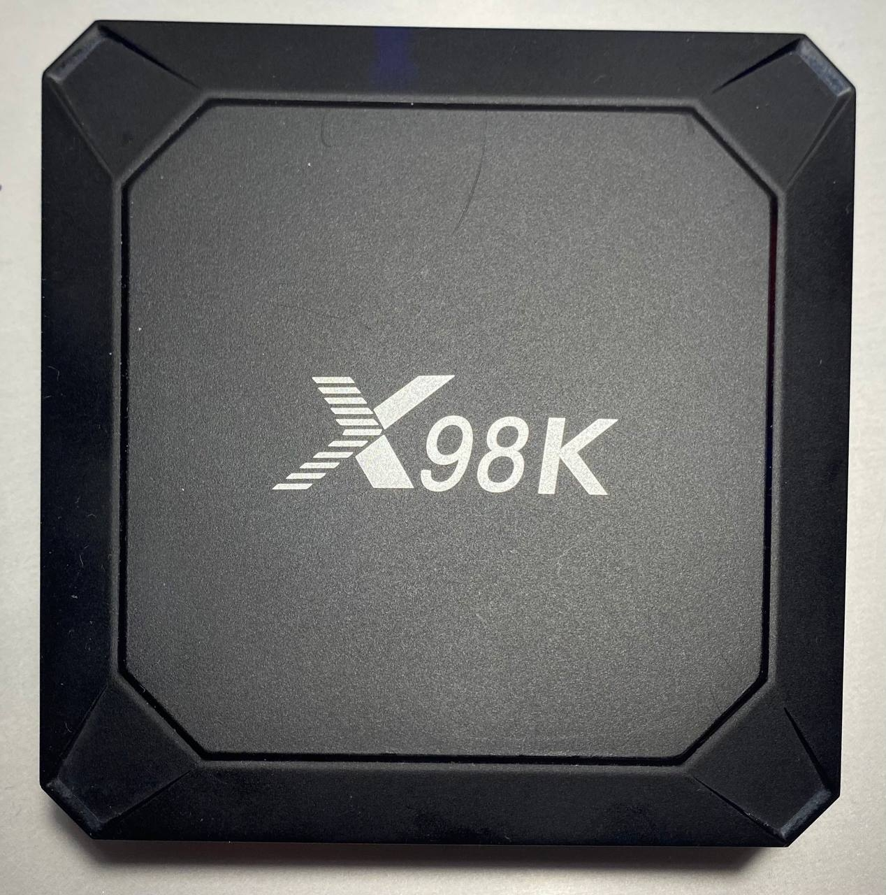
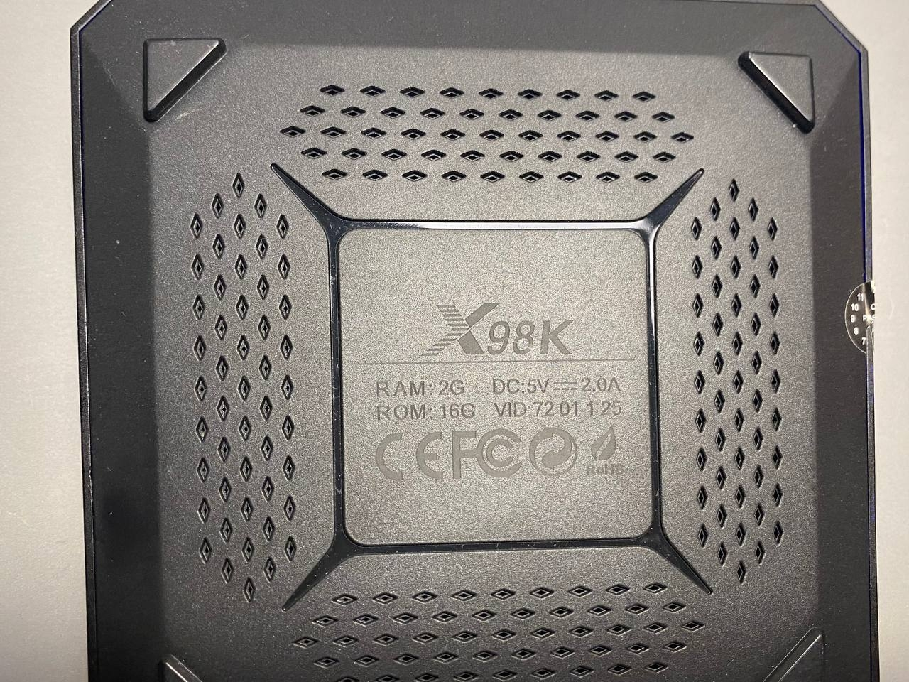
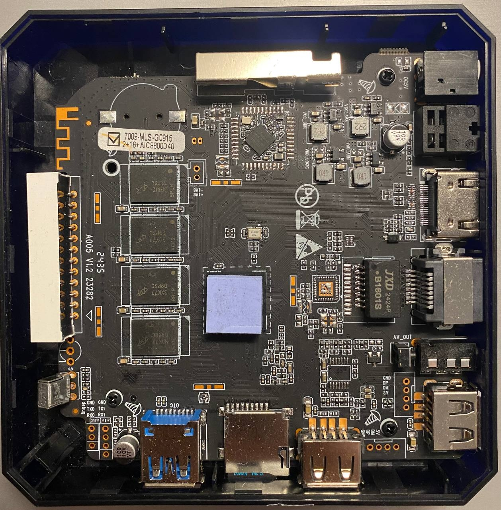

Приствка с надписью X98K 

SoC: Rockchip RK3528

Исходная ОС: Android 13

Исходное ядро Android: Linux 5.10.157

D:\ADB>adb shell uname -a

Linux localhost 5.10.157 #49 SMP PREEMPT Tue Aug 20 10:40:05 CST 2024 aarch64 Toybox

Сборка: Google/ap201/ap201:13/TQ2A.230305.008.F1/xml08201041:userdebug/release-keys.

Ethernet: end0  - st_gmac - встроенный в Soc контроллер Rockchip GMAC.
Wi-Fi: wlan0 - aicwf_sdio - семейство AIC8800, прошивка 8800d80_u02. Скопировал файлы из android.

Wi-Fi: wlan0 → aicwf_sdio → семейство AIC8800, прошивка 8800d80_u02.

Вариант платы в Armbian: Hungsun X88 TV box

Есть дисплей, многоразрядный светодиодный индикатор на передней панели. 4 символа с двоеточием для часов и иконки.

Использовал образ https://github.com/joilg/x88pro/releases (Armbian-unofficial_26.08.0-trunk_X88pro_resolute_vendor_6.1.115.img.xz)

